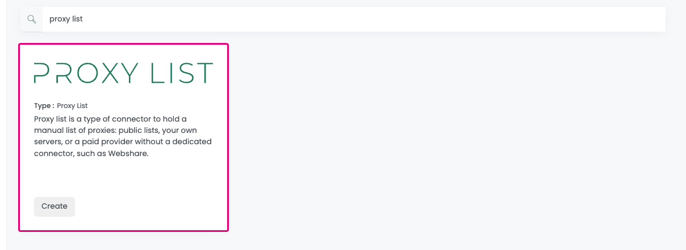
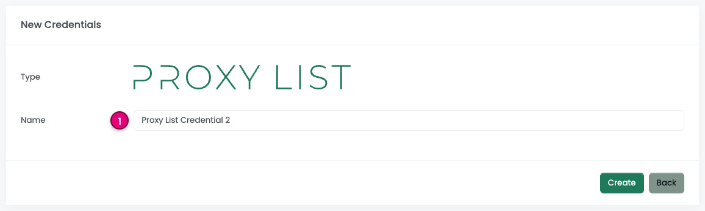
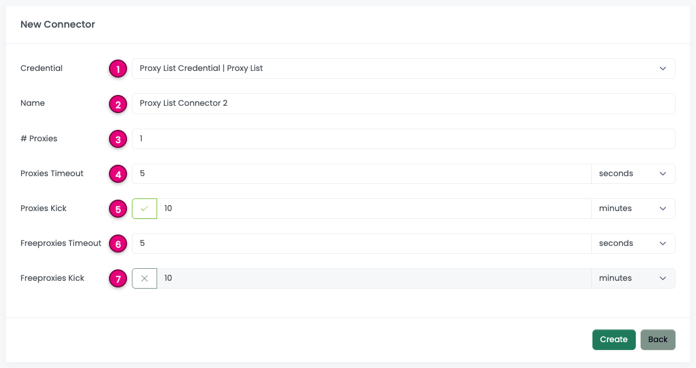
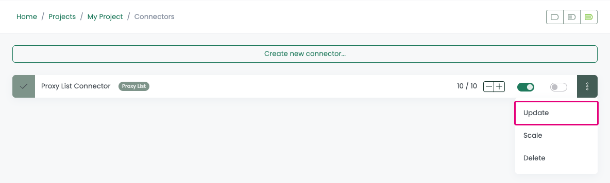
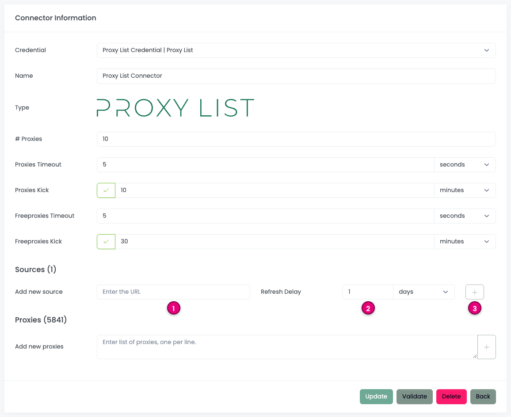
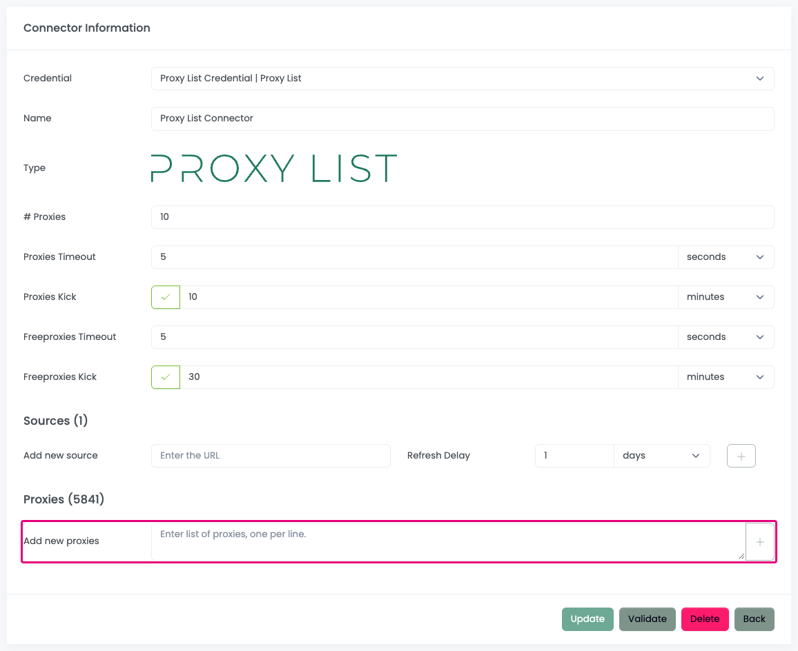
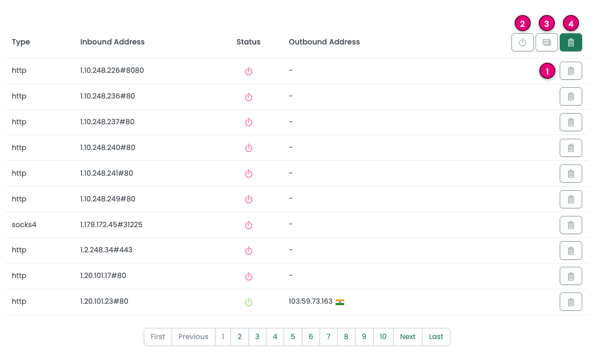
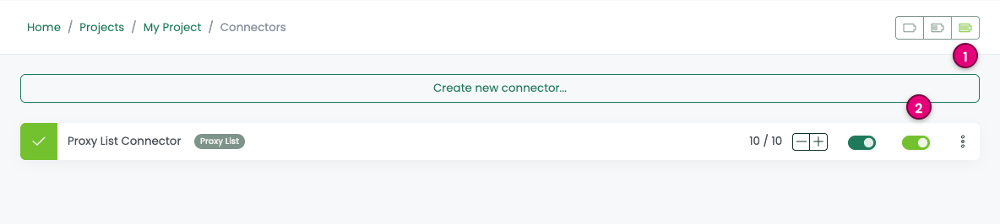
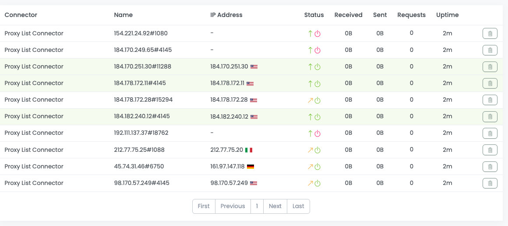
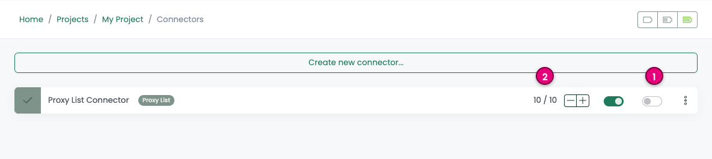

# Proxy List Connector

A _Proxy List_ is a specific type of connector designed to manage a manual list of proxies. 
Users have the flexibility to either utilize their own private proxies or incorporate a list of public proxies available on the Internet.

ProxyHerd supports HTTP/HTTPS proxies and SOCKS4/SOCKS5 proxies.

Check out this [video](https://www.youtube.com/watch?v=Uw_xEvIMleY) from [ProxyScrape](https://proxyscrape.com):

<iframe width="560" height="315" src="https://www.youtube.com/embed/Uw_xEvIMleY?si=Pwx1QOzc6W4erU1w" title="YouTube video player" frameborder="0" allow="accelerometer; autoplay; clipboard-write; encrypted-media; gyroscope; picture-in-picture; web-share" referrerpolicy="strict-origin-when-cross-origin" allowfullscreen></iframe>

Or this [video](https://www.youtube.com/watch?v=Dk1c6FETufg) from [Proxy-Sale](https://proxy-sale.com):

<iframe width="560" height="315" src="https://www.youtube.com/embed/Dk1c6FETufg?si=1EO3-S0jruFiUQKK" title="YouTube video player" frameborder="0" allow="accelerometer; autoplay; clipboard-write; encrypted-media; gyroscope; picture-in-picture; web-share" referrerpolicy="strict-origin-when-cross-origin" allowfullscreen></iframe>

For instance, public proxies can be obtained from:
- [ProxyScrape](https://proxyscrape.com/free-proxy-list)
- [Spys One](https://spys.one)
- [IPRoyal](https://iproyal.com/free-proxy-list)
- [Free Proxy CZ](http://free-proxy.cz)
- [Free Proxy World](https://www.freeproxy.world)
- [Proxy List Download](https://www.proxy-list.download)
- [Scraping Ant](https://scrapingant.com/free-proxies)
- [ProxyDB.net](https://proxydb.net)
- ...

Open a [discussion](https://github.com/proxyherd/proxyherd/discussions) if you would like to contribute and add your proxy list.

::: warning
Please note that using this connector with Pay-Per-GB subscriptions
without proper configuration can lead to substantial costs.
:::

## Paid proxy lists (Webshare and others)

The connector is called _Proxy List_ (and _Free Proxies_ in a few field names) because of **how the proxies are supplied**, as a list, not because of their price. Any provider that hands you a list of `ip:port` or `ip:port:username:password` entries works with it, including paid plans from providers without a dedicated connector yet, such as [Webshare](https://www.webshare.io).

With Webshare:

1. In the Webshare dashboard, open **Proxy list**, choose the download format `ip:port:username:password` and copy the **download link**. It is a stable URL on `proxy.webshare.io` that always returns your current list.
2. In ProxyHerd, create a `Proxy List` credential, which is only a holder ([Step 1](#step-1-create-a-new-credential)), then a `Proxy List` connector with the number of proxies you want to use ([Step 2](#step-2-create-a-new-connector)).
3. On the connector, click `Update` and add the download link as a **source** with a daily refresh, `86400000` ms ([Step 3](#step-3-add-a-proxies-source)). ProxyHerd fetches the list on that schedule, so rotated or replaced proxies arrive on their own. Pasting the list in the textarea works too ([Step 4](#step-4-add-manually-some-proxies)); the accepted line formats are listed there.
4. Leave `Freeproxies Kick` disabled, or set it to a generous value. Paid proxies are stable, and a kicked proxy leaves the pool until the next fetch of the list.
5. Start the connector ([Step 5](#step-5-start-the-connector)). The proxies appear online once they have fetched the [fingerprint service](/deployment/fingerprint).

Other providers work the same way, as long as their list is reachable at a URL or can be pasted. The warning above about pay-per-GB plans still applies: every health check goes through the proxies, see [Sizing and proxy traffic](/deployment/fingerprint#sizing-and-proxy-traffic).

## ProxyHerd

Open ProxyHerd User Interface and select `Marketplace`:

### Step 1: Create a new credential

Select `Proxy List` to create a new credential (use search if necessary).

---

Complete the form with the following information:
1. **Name**: The name of the credential

And click on `Create`.

::: info
This credential is a holder for the proxy list connector
because ProxyHerd always needs a credential to create a connector.
:::

### Step 2: Create a new connector

Create a new connector and select `Proxy List` as provider:

Complete the form with the following information:
1. **Credential**: The previous credential;
2. **Name**: The name of the connector;
3. **# Proxies**: The number of instances to create;
4. **Proxies Timeout**: Maximum duration for connecting to a proxy before considering it as offline;
5. **Proxies Kick**: If enabled, maximum duration for a proxy to be offline before being removed from the pool;
6. **Freeproxies Timeout**: Same as `Proxies Timeout` but for the freeproxies pool;
7. **Freeproxies Kick**: Same as `Proxies Kick` but for the freeproxies pool.

:::info
Adjust `Freeproxies Timeout` to a higher value to avoid removing proxies from the freeproxies pool too quickly.
:::

### Step 3: Add a proxies source

On the connector, click on `Update`.

---

1. Fill the URL of the proxy list;
2. Choose the refresh rate;
3. Click on `Add`.

Here is a good URL example from [ProxyScrape](https://api.proxyscrape.com/v3/free-proxy-list/get?request=displayproxies&proxy_format=protocolipport&format=text).
The URL must return a list of proxies, one per line. 
ProxyHerd will automatically fetch the list of proxies from the URL and update the connector.

::: info
It is recommended to activate `Freeproxies Kick` to curate offline proxies from the freeproxies pool.
Proxies will be added again when ProxyHerd fetches the list from the URL.
:::

### Step 4: Add manually some proxies

Copy / Paste a list of proxies in the textarea.

ProxyHerd supports theses formats:
- `ip:port`
- `ip:port:username:password`
- `http://ip:port`
- `http://username:password@ip:port`
- `https://ip:port`
- `https://username:password@ip:port`
- `socks://ip:port` (shortcut for `socks5://ip:port`)
- `socks://username:password@ip:port` (shortcut for `socks5://username:password@ip:port`)
- `socks4://ip:port`
- `socks4://username:password@ip:port`
- `socks5://ip:port`
- `socks5://username:password@ip:port`

--- 

ProxyHerd will assess the availability of proxies and retain only those
that are currently accessible for the connector.

The provided buttons offer the following functionalities:
1. **Delete One Proxy**: Remove a specific proxy from the list;
2. **Delete Offline Proxies**: Eliminate proxies that are either offline or in a waiting state for fingerprinting;
3. **Delete Duplicates**: Remove proxies that share the same outbound IP address;
4. **Delete All Proxies**: Clear the entire proxy list.

### Step 5: Start the connector

1. Start the project;
2. Start the connector.

---

You can use the proxies on the connector.

### Other: Stop the connector

1. Stop the connector;
2. Wait for proxies to be removed.
