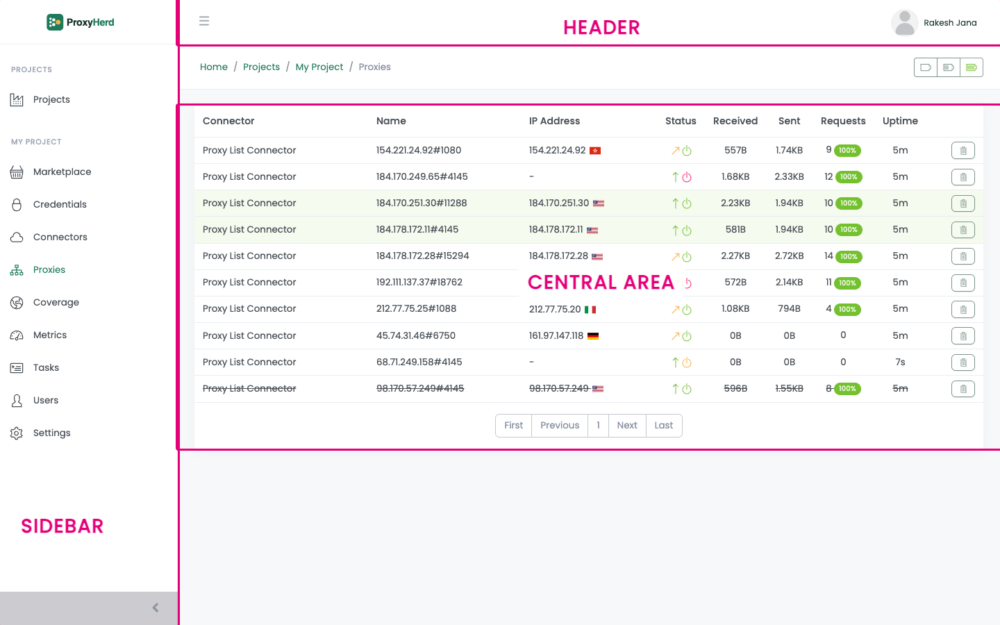

# ProxyHerd

## What is ProxyHerd?

ProxyHerd is a **super proxy manager** that orchestrates all your proxies from **one place 🎯**,
rather than spreading management across multiple scrapers 🕸️.

Deployed on your own infrastructure, ProxyHerd serves as a **single proxy endpoint** for your scrapers.

It builds a pool of private proxies from your cloud subscription 🔒,
integrates them with proxy vendors 🔌, checks the health and location of every proxy,
manages IP rotation, and smartly routes traffic to **avoid bans** 🚫.

 

## What is not ProxyHerd?

ProxyHerd is not:
- a proxies list manager like [ProxyBroker2](https://github.com/bluet/proxybroker2);
- a webscraper like [Scrapy](https://scrapy.org), [Crawlee](https://crawlee.dev) or [Octoparse](https://www.octoparse.com);
- a cloud provider like [AWS](https://aws.amazon.com), [GCP](https://cloud.google.com) or [Azure](https://azure.microsoft.com);
- a browser farm like [Puppeteer](https://pptr.dev), [Selenium](https://www.selenium.dev) or [Playwright](https://playwright.dev);
- a proxy service like [Rayobyte](https://rayobyte.com), [IP Royal](https://iproyal.com) or [Zyte](https://www.zyte.com).

## Where ProxyHerd comes from

ProxyHerd is a community fork of **Scrapoxy 4.17.4**, created in October 2026.

Scrapoxy was started in 2015 by Fabien Vauchelles and published under the MIT licence
until version 4.17.4 (December 2024). Later versions moved to a different licence, then to a
proprietary one, and the project was discontinued in 2026 together with the hosted
service it depended on for proxy health checks.

The MIT licence on the code up to 4.17.4 cannot be withdrawn, so this fork continues
from exactly that commit. The full upstream history is preserved in the repository as
provenance, and a `NOTICE` file records the origin.

ProxyHerd is not affiliated with, endorsed by, or supported by the original author
or CoreDump Engineering. "Scrapoxy" is a trademark of its author; it is used here only
to describe where this project comes from.

## What changed from Scrapoxy 4.17.4

- **Self-hosted fingerprint service.** The hosted service that checked whether a proxy was online and
  resolved its location no longer exists. ProxyHerd ships its own, running on your infrastructure
  from a local GeoIP database. Nothing is reported to a third party.
- **No telemetry.** The health-check request no longer carries an installation identifier or traffic counters.
- **New name everywhere a user sees it**: package, binary, container image, Helm charts and this documentation.
- **Everything else is compatible.** Configuration files, storage, the REST API, the `X-Scrapoxy-*`
  headers, the sticky-session cookie and the naming of cloud instances are unchanged, so an
  existing 4.17.4 installation upgrades in place.
